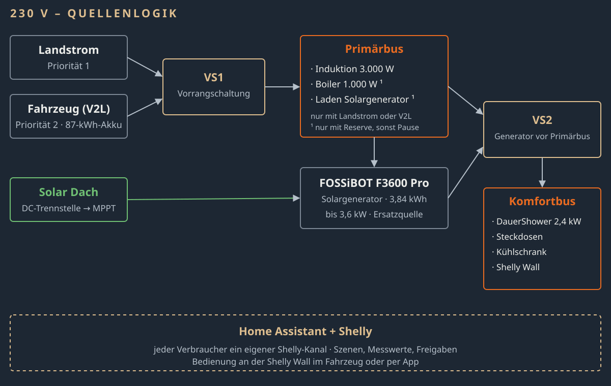

# CA Camping – Open Concept

Offener Standard für den **vollelektrischen Camper auf dem Renault Master E-Tech** (L2H2, 3,5 t):
Elektroplan, Wasseranlage, Heizung/Klima und eine Home-Assistant-Integration, die die Energielogik im Fahrzeug umsetzt.

🌐 Webseite: <https://open-concept.ca-camping.de/> · Werkstattverbund: <https://verbund.ca-camping.de/>

> **Status:** Planungsstand Oktober 2026, erstes Fahrzeug im Bau. Alles hier ist Entwurf und vor der Ausführung zu prüfen.

## Inhalt

| Bereich | Datei | Stand |
|---|---|---|
| Elektroplan (230 V, 12 V, 24 V, Solar) | [docs/elektrik.md](docs/elektrik.md) | Entwurf v5 |
| Wasseranlage | [docs/wasser.md](docs/wasser.md) | v9 |
| Heizung und Klima | [docs/heizung.md](docs/heizung.md) | Entwurf |
| Home-Assistant-Integration `ca_camper` | [custom_components/ca_camper](custom_components/ca_camper) · [Anleitung](docs/integration.md) | v0.4.0 |

## Home-Assistant-Integration „CA Camper Energiemanager“

Die Integration nutzt Entitäten, die andere Integrationen bereits liefern
(Shelly-Schalter und -Leistungsmessung, Ladestand des Solargenerators, Landstrom-/V2L-Erkennung, Truma über BlueBattery,
Infrarot-Paneel) und setzt die Logik des Elektroplans um:

- **Vorrangschaltungen:** welche Quelle gerade welchen Bus speist (Landstrom vor V2L → Primärbus; Solargenerator vor Primärbus → Komfortbus – im Normalfall zwei unabhängige Kreise)
- **Leistung, Grenze und Reserve je Bus**
- **Laden aus der Fahrzeugbatterie** nur, wenn der Solargenerator unter 30 % fällt (bis 80 %); Landstrom lädt jederzeit
- **Freigabe nach Reserve:** Boiler-Heizstab und Laden des Solargenerators laufen nur, wenn die Quelle sie zusätzlich trägt – sonst Pause, danach automatischer Wiederanlauf
- **Feste Verbraucher** (Induktion, DauerShower, Kühlschrank …) werden nie geschaltet; für sie gibt es eine **Überlast-Warnung**

Installation über HACS (benutzerdefiniertes Repository, Kategorie *Integration*), dann
**Einstellungen → Geräte & Dienste → Integration hinzufügen → CA Camper Energiemanager**.
Details: [docs/integration.md](docs/integration.md).

> ⚠️ Die Integration ersetzt keine elektrische Schutzeinrichtung (Leitungsschutz, RCD, Umschalttechnik).

## Mitmachen

Fehler gefunden, besseres Bauteil, eigener Nachbau? Issues und Pull Requests sind willkommen – siehe
[CONTRIBUTING.md](CONTRIBUTING.md). Werkstätten und Elektrofachkräfte: <https://verbund.ca-camping.de/>.

## Lizenzen

- **Dokumentation, Pläne, Tabellen, Diagramme** (`docs/`): © 2026 Jochen Kleimann / CA Camping – Open Concept,
  [CC BY-SA 4.0](https://creativecommons.org/licenses/by-sa/4.0/deed.de) – siehe [LICENSE-DOCS.md](LICENSE-DOCS.md).
- **Software** (`custom_components/`, `tests/`): [Apache License 2.0](LICENSE).
- Nicht lizenziert: Marke „CA Camping“, Logos, Fotos, die Bezeichnung „nach CA-Standard ausgebaut“,
  der Möbelgrundriss der Campermanufaktur Berlin.

Alle Inhalte werden ohne Gewähr bereitgestellt. Sie ersetzen weder Planung und Abnahme durch eine Elektrofachkraft
noch die Beachtung geltender Normen, Herstellerangaben und der Aufbaurichtlinien des Fahrzeugherstellers.
Genannte Marken (Renault, Home Assistant, Shelly, FOSSiBOT, Truma, Dometic, DauerShower, Lilie, WM Aquatec, BlueBattery,
Könighaus u. a.) gehören ihren Inhabern und werden nur beschreibend genannt; eine Verbindung besteht nicht.

---

*English summary:* Open standard for a fully electric camper van based on the Renault Master E-Tech: wiring plan,
water system, heating, and a Home Assistant custom integration (`ca_camper`) that shows source priority,
per-bus power, limit and headroom on top of existing entities, and pauses "headroom-only" loads (boiler heater, generator charging) when the source cannot carry them; fixed loads are never switched. Docs CC BY-SA 4.0, code Apache-2.0.
