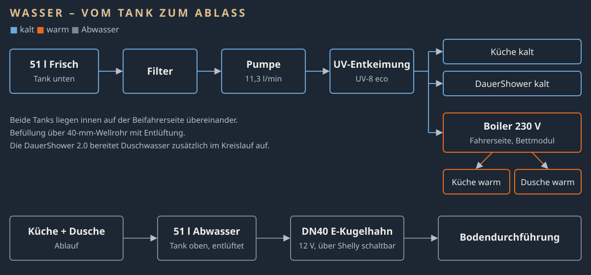

# Wasseranlage (v9) – CC BY-SA 4.0

- 2 × 51-l-Extra-Flach-Tank, Beifahrerseite, übereinander: unten Frisch, oben Abwasser (eigene Tragstruktur)
- Befüllung: 40-mm-Wellrohr mit Entlüftung
- Frisch: Tank → Lilie Aufschraubfilter → Lilie LP4142 (11,3 l/min, 2,1 bar) → WM Aquatec UV-8 eco → Kaltwasserverteilung
- Kalt: 12/18 mm blau → Küche, DauerShower, Boiler; Absperrventile je Zweig
- Warm: Boiler PEKAWAY SafeBoil 10 l, Edelstahl (Heizstäbe 230 V/1.000 W und 12 V/200 W, Warmluftanschluss, Sicherheitsventil 3 bar/95 °C; Fahrerseite, Bettmodul) → 12/18 mm rot → Küche, DauerShower
- Abwasser: Küche + Dusche → oberer Tank → DN40 → elektrischer Kugelhahn → Bodendurchführung; 19-mm-Entlüftung

## Montage-Reihenfolge
1 Tanks positionieren · 2 Tankdurchführungen · 3 DN40-Ablass · 4 Filter + Pumpe · 5 UV · 6 Verteilung kalt · 7 Boiler + warm · 8 Druck-/Dichtprüfung

## Offen
Zuordnung Tankdurchführungs-Sets, FAWO-Verschraubung, DN40-Verbinder beim Trockenaufbau.

## Vor dem Bohren prüfen
- Tanks trocken mit dem realen Möbel-/Bettmodul aufbauen; Serviceöffnungen markieren.
- Biegeradius der 40-mm-Füllleitung prüfen.
- Position von Tankdurchführung, Kugelhahn und Bodendurchführung festlegen.
- 19-mm-Entlüftung kurz und steigend führen.
- Pumpe, Filter und UV-Einheit zugänglich anordnen; Durchflussbegrenzung der UV-Einheit beachten.
- Schlauchschellen erst nach dem Trockenaufbau endgültig setzen.

## Abnahme
Tanks dicht · Befüllung dicht und entlüftet · Filter→Pumpe dicht, Pumpe schwingungsentkoppelt · UV in Fließrichtung ·
Kalt- und Warmwasser dicht · Abwasser läuft vollständig ab · Kugelhahn schaltet zuverlässig · Abwassertank entlüftet ·
Serviceöffnungen nach Möbelmontage erreichbar.
